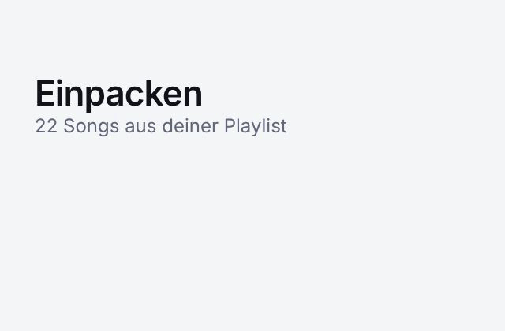

# Umzugskiste



Zieht Playlists zwischen Spotify und SoundCloud um. Offline-first PWA ohne Konto und ohne Build-Schritt.

## Was geht

- **Einpacken:** Spotify-Playlists und Lieblingssongs, SoundCloud-Sets und gelikte Tracks, Text, CSV, JSON, M3U
- **Umziehen:** in neue oder bestehende Playlists und Sets, auch in Likes
- **Abgleich:** ISRC, Titel, Künstler, Länge. Andere Versionen (Extended Mix, Radio Edit) kommen zur Prüfung
- **Teilen:** Die Kiste steckt gepackt im `#`-Teil des Links, kein Server sieht sie
- **Nachziehen:** Neue Songs per Knopf ins Ziel holen. Hintergrund-Sync bräuchte einen Server
- **Offline:** Packen, ansehen, exportieren und teilen geht ohne Netz. Umzüge laufen online an gleicher Stelle weiter

YouTube Music, Apple Music, TIDAL, Deezer und Amazon Music sind ausgegraut und können später dazukommen. Frühere Adapter für YouTube und Deezer stehen in der Git-Historie (`43fa24a`).

## Einrichtung

**Spotify:** Jeder Nutzer legt im Developer Dashboard eine eigene App an (Premium nötig), weil der Dev-Mode nur fünf Nutzer je Client ID erlaubt. Schritte stehen in der App.

**SoundCloud:** Einmalig durch den Betreiber. SoundCloud verlangt beim Token-Tausch ein Client Secret, das nicht in den Browser darf. Darum gibt es eine kleine Funktion unter `supabase/functions/soundcloud-token`, sonst keinen Server.

1. Unter „Your Apps“ eine App anlegen, Artist Pro nötig. Redirect URI ist die Adresse der Seite.
2. Funktion deployen: `supabase functions deploy soundcloud-token --no-verify-jwt`
3. Secrets setzen: `SOUNDCLOUD_CLIENT_ID`, `SOUNDCLOUD_CLIENT_SECRET`, `ALLOWED_ORIGINS`, `ALLOWED_REDIRECTS`
4. In `src/config.js` Client ID und Funktions-URL eintragen

Lokal muss die Adresse `http://127.0.0.1:5173/` sein, Spotify lehnt `localhost` ab.

## Einschränkungen

- Kisten liegen pro Gerät im Browser, mit Sicherungsdatei übertragbar
- SoundCloud-Limits gelten für alle Nutzer zusammen: rund 100 Anfragen pro Minute, 3.000 Suchen pro Stunde, 500 Likes am Tag
- Spotify gibt Songs nur aus eigenen und kollaborativen Playlists heraus

## Entwicklung

```sh
npm start        # http://127.0.0.1:5173/
npm test         # Logik: Parser, Abgleich, Umzug, Teilen, Token-Funktion
npm run e2e      # Browser-Test mit nachgebauten Dienst-APIs, Screenshots in e2e/shots/
```

`e2e` braucht ein global installiertes Playwright. Die App selbst hat keine Abhängigkeiten.

Aufbau: `src/transfer.js` steuert den Umzug, `src/match.js` den Abgleich, `src/services/` die Dienste. Ein neuer Dienst ist ein Adapter mit `search`, `createPlaylist`, `existingIds` und `addTracks` und ein Eintrag in `src/services/index.js`.

## Feedback

Ideen und Fehler gern als [Issue](https://github.com/Oliver19xx/Umzugskiste/issues/new).

## Release

`VERSION` und `CHANGELOG` in `src/model.js`, `package.json` und `CACHE` in `sw.js` anpassen. Neue Dateien in `SHELL` in `sw.js` eintragen, `npm test` prüft beides. Nutzer sehen die Änderungen nach dem Update automatisch.

## Rechtliches

Spotify Developer Policy III.9 verbietet Übertragungen an andere Dienste, nimmt aber Playlist-Metadaten der Nutzer aus. SoundCloud-Terms: keine Audio-Weitergabe, Uploader und Quelle nennen, Secret schützen. Die App überträgt nur Metadaten und verlinkt auf die Originale.

Nicht verbunden mit Spotify, SoundCloud oder Apple und nicht von ihnen unterstützt.
